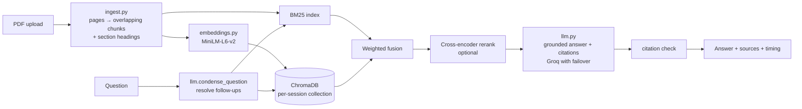

<p align="center">
  
  
  
  
  
  <a href="https://github.com/thakursamir0000-star/NovaBot/actions/workflows/ci.yml"></a>
</p>

<h1 align="center">🚀 NovaBot — AI Book Assistant</h1>

<p align="center">
  <strong>Upload any PDF book and ask questions in plain English — answers come from the book, with citations to the pages they came from, and "I couldn't find this in the book" when the answer isn't there.</strong>
</p>

<p align="center">
  <em>Hybrid retrieval (BM25 + embeddings) · cross-encoder reranking · ChromaDB · Groq · 92.1% answer accuracy, 100% refusal on unanswerable questions, 0 unsupported claims — measured in CI</em>
</p>

<p align="center">
  <a href="https://novabot-hmfpdexedmytfg6ikpju3p.streamlit.app/">
    
  </a>
</p>

---

## ✨ Features

- **📄 Any PDF** — page-aware sliding-window chunking; chunks inherit the chapter/section heading they fall under
- **🔍 Hybrid retrieval** — BM25 for exact terms (names, codes, numbers) + MiniLM embeddings for paraphrases, combined by **weighted score fusion** (chosen by the evaluation below); Reciprocal Rank Fusion and single retrievers are selectable for comparison
- **🎯 Cross-encoder reranking** *(optional)* — MS-MARCO MiniLM re-orders the top candidates using the full passage
- **💬 Follow-up questions** — "explain that more" is rewritten into a standalone query from the chat history before searching
- **📑 Checked citations** — every answer cites `[Source N]`; citations to passages that weren't retrieved are flagged, and uncited answers are marked
- **🙅 Honest abstention** — when the passages don't contain the answer, the bot says *"I couldn't find this in the book."*
- **🔒 Private per visitor** — each browser session gets its own ChromaDB collection, and collections are deleted after 24 hours
- **🛟 Model failover** — if a Groq model is down or retired, the next one answers
- **⏱ Transparent timing** — every answer shows search time, answer time and the rewritten query

## 🏗️ Architecture



| Module | Responsibility |
|---|---|
| `ingest.py` | PDF text per page (pypdf), title, sliding-window chunks with page spans and headings |
| `embeddings.py` | One shared sentence-embedding model, normalized vectors |
| `vector_store.py` | `ChromaStore` (per-session collections, top-n HNSW queries, page filters, expiry) and `InMemoryStore` |
| `retrieval.py` | Tokenizer, BM25, semantic search, weighted / RRF fusion, reranking, page scope |
| `llm.py` | Groq calls with failover, follow-up rewriting, prompt with numbered sources, citation and abstention checks |
| `app.py` | Streamlit UI |
| `evaluation/` | Test document, 44 questions with known answers, evaluation script |

## 📊 Evaluation

NovaBot is evaluated on `evaluation/handbook.txt`, an original 12-page operations handbook for a fictional research station. Because the facts are invented, the LLM can't answer from memory — it has to retrieve them. The 44 questions in `evaluation/questions.jsonl` are:

- **13 keyword questions** that reuse the document's wording ("What does alarm code F-17 mean?"),
- **25 paraphrased questions**, several with almost no words in common with the text ("most frequent way people get hurt" → "most common injury … twisted ankle"),
- **6 unanswerable questions** the handbook doesn't cover ("Is there Wi-Fi in the cabins?").

Each answerable question has an evidence phrase (which passages count as relevant) and the key facts a correct answer must contain.

| Layer | Metrics |
|---|---|
| 1 · Retrieval | Recall@1/3/5, MRR@10, nDCG@5 — overall and for keyword vs paraphrase questions — for BM25, semantic, weighted fusion, RRF, and both with reranking |
| 2 · Answers | Key-fact accuracy · abstention on unanswerable questions · false-abstention rate · citation validity · citation support (a cited passage contains the evidence) · faithfulness (LLM judge checks every claim against the passages) |
| 3 · System | Index build time · retrieval latency p50/p95 per method · answer latency p50/p95 · tokens per answer |

```bash
python evaluation/evaluate.py              # layers 1 + 3 (downloads the embedding and reranker models)
python evaluation/evaluate.py --with-llm   # + layer 2, needs GROQ_API_KEY
python evaluation/evaluate.py --doc my_book.pdf --questions my_questions.jsonl
```

CI runs the retrieval evaluation with the real models on every push and posts the table in the run summary; the answer evaluation runs too when a `GROQ_API_KEY` repository secret is set.

### Results

Measured by CI on 2026-10-29: `all-MiniLM-L6-v2` embeddings, `ms-marco-MiniLM-L-6-v2` reranker, `openai/gpt-oss-120b` via Groq; the handbook cut into 32 chunks.

**Retrieval** (38 answerable questions)

| Method | Recall@1 | Recall@3 | Recall@5 | MRR@10 | nDCG@5 | Recall@5 keyword | Recall@5 paraphrase | Latency p50 |
|---|---|---|---|---|---|---|---|---|
| BM25 only | 0.763 | 0.842 | 0.842 | 0.803 | 0.793 | 1.000 | 0.760 | < 1 ms |
| Semantic only | 0.763 | 1.000 | 1.000 | 0.873 | 0.877 | 1.000 | 1.000 | 10 ms |
| **Weighted hybrid (default)** | **0.842** | 0.974 | **1.000** | **0.910** | **0.908** | 1.000 | 1.000 | 10 ms |
| RRF hybrid | 0.789 | 0.895 | 0.974 | 0.866 | 0.863 | 1.000 | 0.960 | 10 ms |
| Weighted + rerank | 0.895 | 0.974 | 1.000 | 0.941 | 0.940 | 1.000 | 1.000 | 348 ms |
| RRF + rerank | 0.895 | 0.974 | 1.000 | 0.940 | 0.939 | 1.000 | 1.000 | 362 ms |

What this shows:
- **Keywords alone aren't enough.** BM25 misses 24% of the reworded questions; semantic search finds all of them in the top 5.
- **Hybrid ranks the right passage first more often** than either retriever alone (Recall@1 0.842 vs 0.763).
- **Weighted fusion beat RRF here** (MRR 0.910 vs 0.866), so it is the default. RRF gives BM25's ranking an equal vote even on questions where BM25 matches the wrong words.
- **Reranking gives the best ranking** (MRR 0.94) but is ~35× slower on CPU, so it stays an option.
- 38 questions over 32 chunks is small: one question moves Recall by 0.026.

**Answers** (44 questions, weighted hybrid, top-5 passages)

| Metric | Result |
|---|---|
| Answer accuracy (key facts present) | **0.921** (35 / 38) |
| Says "I couldn't find this in the book" for unanswerable questions | **1.00** (6 / 6) |
| False abstentions (refused an answerable question) | **0.00** (0 / 38) |
| Faithfulness (LLM judge: every claim supported by the passages) | **1.00** (38 / 38 answers judged) |
| Answers with a citation | 0.974 (37 / 38) |
| Citation validity (no citation to a passage that wasn't retrieved) | 1.00 |
| Citation support (a cited passage contains the evidence) | 0.974 |
| Answer latency p50 / p95 | 3.7 s / 6.5 s |
| Tokens per answer | ~734 |

How it got here (two CI runs, same questions):

| | First run (RRF retrieval, strict citation parser) | Current |
|---|---|---|
| Answer accuracy | 0.868 | **0.921** |
| False abstentions | 3 / 38 | **0 / 38** |
| Citation support | 0.14 | **0.974** |
| Latency p50 / p95 | 5.4 s / 11.9 s | 3.7 s / 6.5 s |

- **Citation support 0.14 → 0.97 was a measurement bug, not better answers.** The first parser only recognised the exact `[Source N]` form, but gpt-oss often writes `【Source 1】`, `[Source 1, 3]` or `【1†source】`. Answers were already judged fully faithful; once the parser accepted these formats, the citations were found.
- **Accuracy and false abstentions improved with the switch to weighted retrieval**, which puts the right passage in front of the LLM more often. LLM output also varies a little between runs (temperature 0.2), so small differences shouldn't be over-read.
- The CI summary lists the remaining misses and uncited answers for each run.

## 🚀 Getting Started

```bash
git clone https://github.com/thakursamir0000-star/NovaBot.git
cd NovaBot
python -m venv venv
venv\Scripts\activate            # Windows  (source venv/bin/activate on Linux/Mac)
pip install -r requirements.txt
```

Create a `.env` file:

```env
GROQ_API_KEY=your_groq_api_key_here
```

```bash
streamlit run app.py
```

Open http://localhost:8501, upload a PDF, and ask away. A local `./chroma_db/` folder is created automatically (git-ignored).

### Settings (sidebar)

| Setting | Default | Notes |
|---|---|---|
| Sources to retrieve | 5 | Passages given to the LLM |
| Retrieval method | Hybrid — weighted | Also: RRF hybrid, BM25 only, semantic only |
| Chunk size | 500 words | Changing it builds a new index (the old vectors are never reused for differently cut chunks) |
| Chunk overlap | 100 words | Capped at half the chunk size |
| Cross-encoder reranking | Off | More precise, slower |
| Page-range scope | Off | Search only selected pages |

Environment variables: `GROQ_MODEL` (default `openai/gpt-oss-120b`), `GROQ_FALLBACK_MODELS` (comma-separated), `EMBEDDING_MODEL` (default `all-MiniLM-L6-v2`).

## 🧪 Testing

```bash
pip install -r requirements-dev.txt
ruff check .
pytest
```

The 50 tests run without network access or an API key: a fake Groq client, a hashing stand-in for the embedding model, and real ChromaDB in a temporary folder. They cover chunking, tokenization, every retrieval method and both fusions, reranker input, index reuse, per-session isolation and expiry, citation and abstention checks, model failover (including failures mid-stream), the evaluation metrics, and a Streamlit smoke test that clicks **Re-index**.

## 🧠 Design notes

- **Why weighted fusion over RRF?** RRF was the first default because it needs no tuning, but the evaluation showed weighted fusion (0.4 BM25 / 0.6 semantic, each min-max normalized) ranks the right passage higher (MRR 0.910 vs 0.866), so the default followed the data.
- **Why a fixed abstention sentence?** It makes "doesn't hallucinate when the book has no answer" measurable.
- **Why chunk settings in the document ID?** The same PDF cut differently is a different index; reusing vectors across chunkings silently returns the wrong passages.
- **What was removed:** an LDA "topic boost" (worth at most 1.5% of the score and zero on PDFs without "Chapter N" headings) and the unused "hierarchical tree", along with their scikit-learn and NLTK dependencies.

## ⚠️ Limitations

- Scanned PDFs (images) have no extractable text; OCR isn't included.
- The evaluation document is small (12 pages); results on long books will differ — run the script on your own PDF and questions.
- The faithfulness judge is the same model family that writes the answers.
- Embeddings are English-focused (MiniLM).
